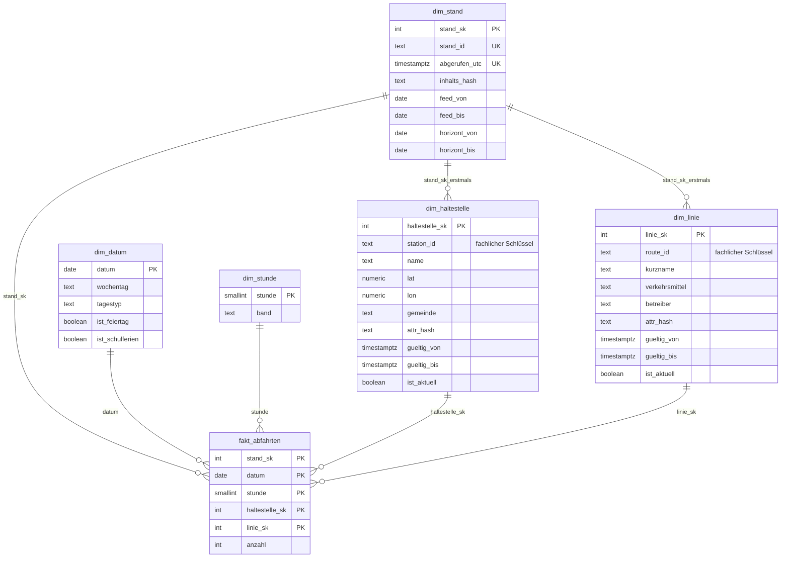
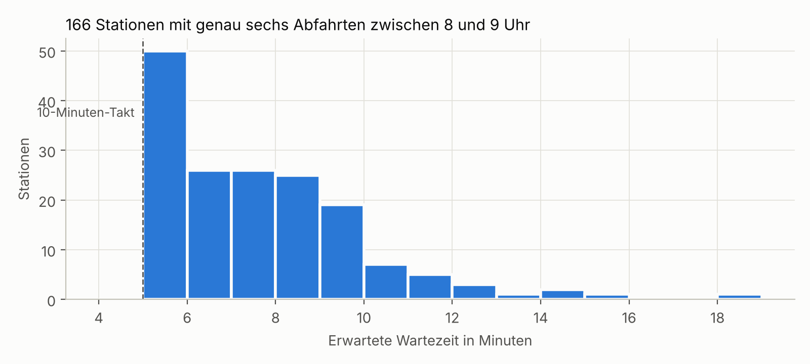
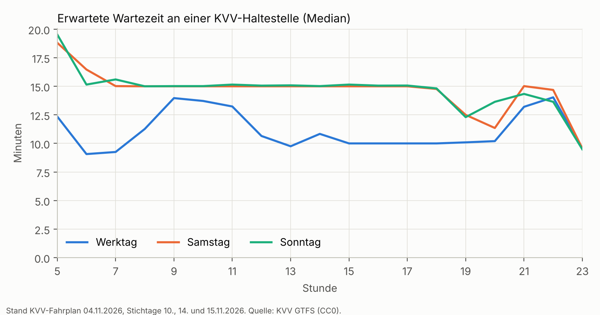
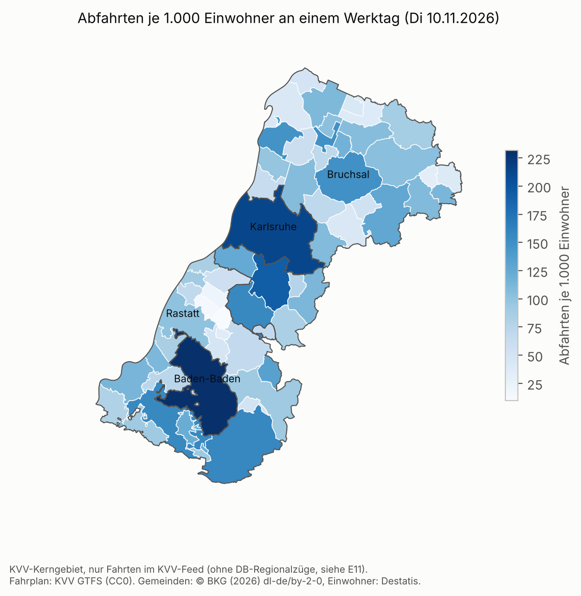

# KVV-Fahrplanmonitor

*Entwurf, Stand Phase 3. Wird mit jeder Phase weitergeschrieben.*

## Worum es geht

Der Karlsruher Verkehrsverbund veröffentlicht seinen Soll-Fahrplan als GTFS-Datei und aktualisiert sie laut MobiData BW nahezu täglich. Alte Stände hält der KVV nicht vor. Ich lade deshalb seit dem 2026-11-03 jeden Tag den aktuellen Stand herunter und baue daraus ein eigenes Archiv auf. Diesen Datensatz gibt es sonst nirgends.

Zwei Fragen stehen im Mittelpunkt:

1. **Bedienqualität:** Wie gut ist welcher Ort im KVV-Gebiet angebunden, nach Stunde und Wochentag? Wo endet der Takt abends oder am Sonntag?
2. **Fahrplanstabilität:** Was ändert sich von Stand zu Stand, bei welchen Linien und Haltestellen am häufigsten, und wann?

Technisch zeigt das Projekt vor allem eines: wie man Daten, die sich über die Zeit ändern, sauber historisiert (Slowly Changing Dimensions Typ 2). Der ÖPNV ist der Anwendungsfall, die Methode ist übertragbar.

## Stand

| Phase | Inhalt | Status |
|---|---|---|
| 0 | Sammelskript, täglicher Abruf mit Hash | läuft seit 2026-11-03 |
| 1 | Repo-Gerüst, Docker Compose, README-Entwurf | fertig |
| 2 | GTFS einlesen, Betriebstage auflösen, Bedienqualität | fertig |
| 3 | PostgreSQL-Modell mit SCD2-Dimensionen | fertig |
| 4 | Diff-Logik zwischen Ständen, Fahrplanstabilität | offen |
| 5 | PySpark für das wachsende Archiv | offen |
| 6 | Power-BI-Dashboard | offen |

## Wie das Sammeln funktioniert

`sammler/sammle_snapshot.py` lädt die ZIP von `projekte.kvv-efa.de/GTFS/google_transit.zip`, prüft, ob alle nötigen GTFS-Dateien drin sind, und berechnet zwei Hashes:

- den **ZIP-Hash** über die Datei als Ganzes,
- den **Inhalts-Hash** über die einzelnen GTFS-Dateien.

Ob ein Stand neu ist, entscheide ich am Inhalts-Hash. Wird die ZIP nur neu gepackt, ändert sich der ZIP-Hash, der Fahrplan aber nicht. Das würde sonst als Änderung zählen und die Stabilitätsauswertung verfälschen.

Jeder Lauf schreibt eine Zeile in `data/snapshot_register.csv`, mit Status `neu`, `unveraendert` oder `fehler`. Auch Tage ohne Änderung sind damit belegt.

Der Abruf läuft täglich über GitHub Actions (`.github/workflows/sammeln.yml`). Neue Stände hängen als Release an diesem Repo, damit der Git-Verlauf klein bleibt.

Lokal geht es genauso:

```bash
pip install -r requirements.txt
python sammler/sammle_snapshot.py
```

## Manifest und Landing Zone

Zu jedem neuen Stand legt der Sammler ein Manifest ab (`kvv_gtfs_..._manifest.json`) und hängt es mit an das Release. Es listet jede GTFS-Datei mit Größe, SHA-256 und Zeilenzahl. Damit sehe ich, *welche* Datei sich geändert hat, ohne 28,7 MB auszupacken.

Lokal lade ich Releases und Register in MongoDB:

```bash
cp .env.example .env          # Passwörter eintragen
make installieren             # pip install -r requirements-analyse.txt
make start                    # PostgreSQL und MongoDB, nur auf 127.0.0.1
make landing                  # Releases holen, Manifeste und Register in MongoDB
make abfrage                  # welche Dateien haben sich je Stand geändert?
```

In MongoDB (Datenbank `kvv_landing`) liegen zwei Collections:

- `snapshots`: ein Dokument je Stand, also das Manifest plus `release_tag` und `verarbeitet_am`
- `abrufe`: jede Zeile aus dem Register, auch Tage ohne Änderung und Fehlschläge

MongoDB ist eine abgeleitete Schicht. Die Wahrheit sind Register und Releases, und `make landing` baut alles jederzeit neu auf. Warum das so ist und warum der Schlüssel der Stand und nicht der Inhalts-Hash ist, steht in E7.

## Sternschema in PostgreSQL

Jeder gesammelte Stand landet in einem Sternschema. Haltestellen und Linien sind Slowly Changing Dimensions Typ 2: Ändert sich ein Name, eine Koordinate oder ein Betreiber, wird die alte Version geschlossen und eine neue angelegt. So lässt sich für jeden Zeitpunkt sagen, was damals galt, und jede Faktzeile zeigt auf die Version, die zu ihrem Stand gültig war.



Die Faktentabelle zählt Abfahrten je Stand, Kalendertag, Stunde, Station und Linie, für 14 Tage ab dem Abruf (E13). Das Schema liegt nummeriert in `sql/`, der SCD2-Schritt selbst ist SQL (`sql/05_scd2.sql`): ein UPDATE schließt, ein INSERT fügt ein, beides in der Transaktion des Stands (E12). Geladen wird so:

```bash
make start                    # Postgres muss laufen
make laden                    # alle noch nicht geladenen Stände, in zeitlicher Reihenfolge
make pruefen                  # nur die Prüfabfragen
```

`laden/lade_postgres.py` spielt das Schema beim ersten Mal selbst ein, überspringt Stände, die schon da sind, und lässt sich beliebig oft starten. Ein älterer Stand nach einem neueren wird von der Datenbank abgelehnt. Nach jedem Lauf zeigen vier Prüfabfragen, ob es pro Schlüssel höchstens eine aktuelle Version gibt, ob sich Zeiträume überlappen und ob jede Faktzeile ihre gültige Version findet. Beispielabfragen stehen in `sql/abfragen/beispiele.sql`, die ersten Ergebnisse in `docs/befunde.md`.

## Erste Ergebnisse: Bedienqualität

Aus dem Stand vom 04.11.2026, ausgewertet für drei Stichtage (Di 10.11., Sa 14.11., So 15.11.2026). Die Rechnung steht im Notebook [notebooks/ebene1_bedienqualitaet.ipynb](notebooks/ebene1_bedienqualitaet.ipynb), die Zahlen und Prüfungen in [docs/befunde.md](docs/befunde.md).

**Gleich viele Abfahrten heißt nicht gleich gut angebunden.** Zwischen 8 und 9 Uhr haben am Dienstag 166 Haltestellen genau sechs Abfahrten. Nur an 10 davon fahren sie im sauberen 10-Minuten-Takt, und man wartet im Schnitt fünf Minuten. An 20 wartet man im Schnitt zehn Minuten oder länger, im Extremfall 18, weil die Abfahrten gebündelt kommen. Deshalb messe ich neben der Zahl der Abfahrten die erwartete Wartezeit (E10).



**Am Wochenende wartet man länger.** An einer typischen Haltestelle sind es werktags tagsüber 10 bis 14 Minuten, samstags und sonntags fast durchgehend 15.



**Pro Kopf liegen Baden-Baden und Karlsruhe vorn** mit über 200 Abfahrten je 1.000 Einwohner und Werktag. Am unteren Ende ist Vorsicht geboten. Muggensturm hat am Stichtag fast nur Schienenersatzverkehr, und in Orten wie Bad Schönborn oder Graben-Neudorf fehlen die Züge der DB, weil der KVV-Feed sie nicht enthält (E11). Dort zeigt die Karte eher, was im Datensatz fehlt, als wie gut der Ort angebunden ist. Der Abgleich mit kvv.de belegt das: In Graben-Neudorf fehlen zwischen 7 und 9 Uhr 18 von 32 Abfahrten. Wo der Feed vollständig ist, stimmt er dagegen auf die Minute.



## Projektstruktur

```
sammler/        Sammelskript, Manifest, Laden der Landing Zone
data/raw/       heruntergeladene Stände (nicht im Git, liegen in den Releases)
data/           Snapshot-Register
sql/            Sternschema, SCD2, Prüfabfragen für PostgreSQL
laden/          Stände in PostgreSQL laden
spark/          PySpark-Jobs (ab Phase 5)
analyse/        Python-Module: GTFS lesen, Betriebstage, Bedienqualität, Gemeinden
notebooks/      Auswertungen mit Grafiken (Ebene 1)
tests/          pytest für Betriebstag-Logik, Kennzahlen und SCD2
docs/           Entscheidungsprotokoll, Befunde, Grafiken
```

## Daten und Lizenz

Fahrplandaten: Karlsruher Verkehrsverbund, bereitgestellt über MobiData BW, Lizenz **CC0**. Es besteht keine Pflicht zur Namensnennung, ich nenne die Quelle trotzdem.

Gemeindegrenzen und Einwohnerzahlen: © BKG (2026) [dl-de/by-2-0](https://www.govdata.de/dl-de/by-2-0), Datenquellen: https://sgx.geodatenzentrum.de/web_public/gdz/datenquellen/datenquellen_vg_nuts.pdf. Verwendet wird die VG250-EW (Stand 31.12.2025), zugeschnitten auf die Gemeinden des KVV-Kerngebiets. Die Einwohnerzahlen darin stammen von Destatis. Die Datei liegt wegen ihrer Größe nicht im Repo. Für das Notebook wird sie von [gdz.bkg.bund.de](https://gdz.bkg.bund.de) geladen und neben das Repo nach `geodaten/` gelegt, oder der Pfad steht in der Umgebungsvariable `KVV_GEODATEN`. Lizenz und Stand geprüft am 05.11.2026.

Feiertage und Schulferien Baden-Württemberg (`sql/02_dim_datum.sql`): Termine vom [Innenministerium BW](https://im.baden-wuerttemberg.de/de/service/feiertage), vom [Kultusministerium BW](https://km.baden-wuerttemberg.de/de/service/ferien) und für 2025/26 aus dem [Ferienkalender der KMK](https://www.kmk.org/service/ferienregelung/ferienkalender.html). Übernommen sind nur die amtlichen Termine, keine Texte. Geprüft am 08.11.2026.

Code: MIT, siehe LICENSE

## Entscheidungen

Warum ich etwas so gelöst habe und nicht anders, steht in [docs/entscheidungen.md](docs/entscheidungen.md).
